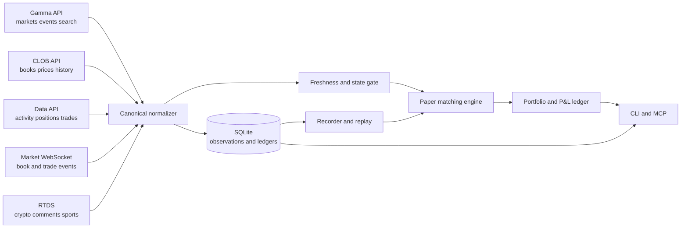

# Project Map

## Boundaries

| Boundary | Responsibility | Not responsible for |
| --- | --- | --- |
| Provider adapters | Fetch and subscribe to public provider data | Hiding provider errors or silently inventing fields |
| Normalizer | Convert provider payloads into versioned domain records | Making stale data appear current |
| Freshness/state gate | Decide whether an observation can drive a simulation action | Guaranteeing an external provider is available |
| Recorder/replayer | Preserve raw and normalized observations for reproducible runs | Claiming synthetic data is equivalent to a live book |
| Matching engine | Simulate paper orders and fills | Signing or submitting real orders |
| Portfolio ledger | Track cash, positions, fees, rebates, exposure, and P&L | Treating paper P&L as realized cash |
| CLI/MCP | Make research operations inspectable and agent-friendly | Bypassing safety gates |

## Primary dependency flow

`provider observations -> normalized market state -> freshness/state gate -> recorded dataset or live paper stream -> matching -> ledger -> report`

## Vault links

- Strategy: [[../02_Strategy/Project_Thesis|Project thesis]]
- Requirements: [[../03_Requirements/Requirements|Requirements]]
- Design: [[../04_Design/System_Overview|System overview]]
- Validation: [[../07_Validation/Validation_Plan|Validation plan]]

